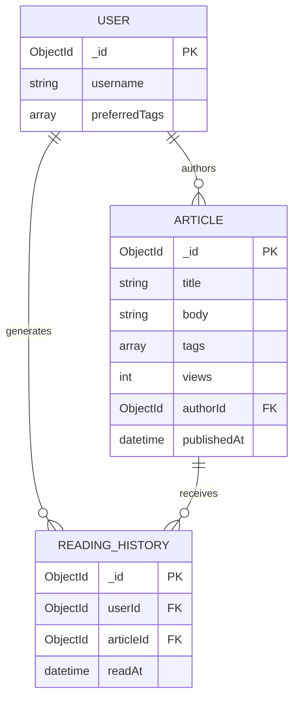
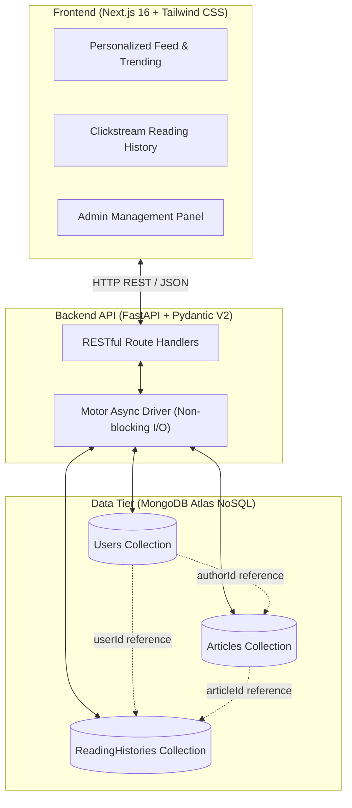

<div align="center">
  
  <h1>News Recommendation Engine</h1>
  <p><i>A highly scalable, personalized NoSQL full-stack platform for real-time content curation and telemetry logging.</i>[cite: 9]</p>

  
  
  
  
  
  

</div>

<br>

## System Overview

The News Recommendation Engine is an asynchronous full-stack web application designed to ingest unstructured news articles, track real-time user reading telemetry, and compute personalized tag-based recommendations at sub-millisecond database latencies[cite: 9]. 

Rather than running heavy in-memory filtering or joining algorithms on backend workers, the system executes complex data transformations directly within MongoDB Aggregation Pipelines, backed by a high-throughput FastAPI ASGI backend and a reactive Next.js 16 dashboard[cite: 9].

---

## Core Capabilities

* **Personalized Recommendations:** Uses `$match` and `$in` aggregation pipelines to intersect user array preferences with live article metadata tags, sorted by popularity[cite: 9].
* **Global Real-Time Trending:** Computes top platform stories utilizing `$sort` and `$limit` aggregations indexed over real-time view counts[cite: 9].
* **Relational Telemetry Tracking (`$lookup`):** Maintains chronological user reading clickstreams with database-level joins, attaching article metadata without client-side N+1 query overhead[cite: 9].
* **Strict Authorship & Content Validation:** Enforces a rigid schema requiring all articles to possess full body content and a verified `authorId` linked directly to a registered user.
* **Interactive Reading Telemetry:** One-click "Read" interaction on the client immediately increments article view counters and appends entries to `ReadingHistories`[cite: 9].
* **Dual-View Dashboard:** Responsive client featuring an end-user personalized feed ("For You", "Trending", "History") and an Admin Management Console for controlling users and global content[cite: 9].

---

## Database Schema (ER Diagram)

The following diagram illustrates the strict relational structure maintained within the MongoDB collections via Pydantic V2 validation.



---

## Architecture & Data Flow



---

## REST API Specification

| Method | Endpoint | Description |
| --- | --- | --- |
| GET | `/` | Service health status check

 |
| GET | `/db-status` | Live ping check against MongoDB Atlas cluster

 |
| GET | `/articles/` | List all articles in the database

 |
| POST | `/articles/` | Create a new article with title, body, tags, and assigned authorId |
| GET | `/articles/{id}` | Retrieve details for a single article

 |
| PUT | `/articles/{id}` | Update an article title

 |
| DELETE | `/articles/{id}` | Delete an article

 |
| POST | `/articles/{id}/read` | Log a user reading event and increment view count

 |
| GET | `/articles/trending/` | Top 5 trending articles ordered by views (`$sort`, `$limit`)

 |
| GET | `/users/` | List all registered user profiles

 |
| POST | `/users/` | Register a new user with preferred tag interests

 |
| DELETE | `/users/{id}` | Delete a user profile

 |
| GET | `/users/{id}/recommendations` | Top 5 personalized articles based on tag matching

 |
| GET | `/users/{id}/history` | Chronological reading history joined with article details (`$lookup`)

 |

---

## Installation & Setup

### Prerequisites

* Python 3.10+


* Node.js 18+ and npm


* MongoDB Atlas cluster or local MongoDB instance


---

### 1. Backend Setup

Here are the commands to initialize the backend:

```bash
# Clone the repository
git clone <your-github-repo-url>
cd news-recommendation-engine

# Create and activate Python virtual environment
python3 -m venv venv
source venv/bin/activate

# Install Python dependencies
pip install fastapi uvicorn motor pydantic

# Launch the FastAPI ASGI server
uvicorn main:app --reload --host 127.0.0.1 --port 8000

```

* **Configure database connection:** Open `database.py` and set your `MONGO_DETAILS` connection string (`MONGO_DETAILS = "mongodb+srv://<user>:<password>@cluster.mongodb.net/..."`).


* **Interactive API Documentation (Swagger UI):** `http://127.0.0.1:8000/docs`


* **Alternative API Documentation (ReDoc):** `http://127.0.0.1:8000/redoc`


---

### 2. Frontend Setup

In a separate terminal, execute the following to start the dashboard:

```bash
cd frontend

# Install Node dependencies
npm install

# Start Next.js development server
npm run dev

```

* **Frontend Dashboard:** Open `http://localhost:3000` in your browser.


---

## Database Indexing Strategy (`optimize.py`)

To ensure high-throughput read/write operations under load, the following indexes are maintained:

1. **Multi-key Index on `Articles.tags` (ASCENDING):** Eliminates collection scans when matching articles against user interest arrays (`$in: user_tags`).


2. **Single-Field Index on `Articles.views` (DESCENDING):** Accelerates sorting for trending calculations without memory sort limits.


3. **Compound Index on `ReadingHistories` (`userId`: ASC, `readAt`: DESC):** Optimizes user-specific history retrieval and chronological ordering.

